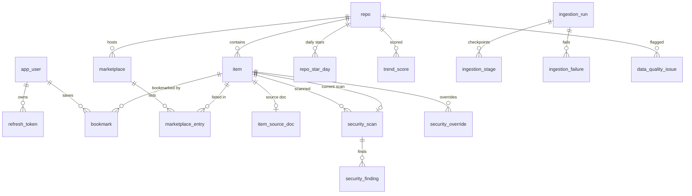

# DATA MODEL — kok.gg

Neon Postgres **DB 1개 · 스키마 2개**. `public` = Prisma 7(NestJS·배치), `ai` = Alembic(FastAPI). 용어는 [UBIQUITOUS_LANGUAGE.md](./UBIQUITOUS_LANGUAGE.md), 소유권 배경은 [ARCHITECTURE.md](./ARCHITECTURE.md) 2장.

## 1. 쓰기 소유권 지도

| 테이블                                                                                                     | 스키마 | 쓰는 쪽                         | 읽는 쪽                                                |
| ---------------------------------------------------------------------------------------------------------- | ------ | ------------------------------- | ------------------------------------------------------ |
| `app_user`, `refresh_token`, `bookmark`                                                                    | public | NestJS API                      | NestJS                                                 |
| `repo`, `marketplace`, `marketplace_entry`, `item`, `item_source_doc`, `repo_star_day`, `trend_score`      | public | 배치(NestJS CLI)                | NestJS, **FastAPI(`repo`·`item`·`item_source_doc`만)** |
| `security_scan`, `security_finding`                                                                        | public | 배치                            | NestJS                                                 |
| `security_override`                                                                                        | public | NestJS API(관리자)              | NestJS·배치                                            |
| `ingestion_run`, `ingestion_stage`, `ingestion_failure`, `data_quality_issue`                              | public | 배치(+ API: run 요청·이슈 처리) | NestJS                                                 |
| `item_summary`, `item_embedding`, `search_doc`, `index_meta`, `search_cache`, `budget_day`, `usage_ledger` | ai     | FastAPI                         | FastAPI, **NestJS는 뷰 2개만**                         |

DB 롤: `kok_app`(NestJS·배치), `kok_ai`(FastAPI). 권한은 7장 `bootstrap.sql`이 강제한다.

---

## 2. ERD (public)



`ai` 스키마 테이블은 `item_id`로 `public.item`을 **논리 참조만** 한다(FK 없음 — 2개 마이그레이션 도구의 순서 결합 방지).

---

## 3. Prisma 스키마 초안 (`backend/prisma/schema.prisma`)

모든 모델은 `@@map`/`@map`으로 **snake_case** 테이블·컬럼 — FastAPI가 raw SQL로 읽기 편하고, 두 언어 사이 이름 번역이 없다. `user`는 Postgres 예약어라 `app_user`.

```prisma
// Prisma 7: datasource URL은 prisma.config.ts(CLI)와 PrismaService의 @prisma/adapter-pg(런타임)가 담당(runboard 패턴).
generator client {
  provider = "prisma-client-js"
}

datasource db {
  provider = "postgresql"
}

// ───────── enums ─────────
enum Role {
  USER
  ADMIN
}
enum RepoStatus {
  CANDIDATE
  TRACKED
  IGNORED
  GONE
  TOO_LARGE
}
enum DiscoverySource {
  TOPIC_SEARCH
  CODE_SEARCH
  AWESOME_SEED
  MARKETPLACE_REF
  MANUAL
}
enum ItemKind {
  PLUGIN
  SKILL
  HOOK
}
enum ItemSourceType {
  IN_REPO
  GITHUB_REPO
  GIT_SUBDIR
  UNSUPPORTED
}
enum ItemStatus {
  ACTIVE
  REMOVED
}
enum RiskLevel {
  SAFE
  CAUTION
  DANGER
}
enum ScanStatus {
  ANALYZED
  UNSUPPORTED
  TOO_LARGE
  ERROR
}
enum TrendWindow {
  D1
  D7
  D30
}
enum IngestionTrigger {
  CRON
  MANUAL
}
enum RunStatus {
  REQUESTED
  RUNNING
  SUCCEEDED
  PARTIAL
  FAILED
}
enum StageName {
  DISCOVER
  QUALIFY
  SNAPSHOT
  STAR_HISTORY
  FETCH_CONTENT
  SECURITY_SCAN
  AI_SYNC
  TRENDING
  QUALITY
}
enum StageStatus {
  PENDING
  RUNNING
  DONE
  PAUSED
  FAILED
  SKIPPED
}
enum DataQualityKind {
  STAR_SOURCE_MISMATCH
  STAR_TOTAL_MISMATCH
  EXTERNAL_MISMATCH
  STAR_ANOMALY
  OFFICIAL_HISTORY_FAILED
}
enum IssueStatus {
  OPEN
  RESOLVED
  IGNORED
}

// ───────── 사용자 ─────────
model User {
  id            Int            @id @default(autoincrement())
  email         String         @unique            // 데모 'admin' 리터럴 포함(로그인 스키마만 형식 우회)
  passwordHash  String         @map("password_hash")
  name          String
  role          Role           @default(USER)
  createdAt     DateTime       @default(now()) @map("created_at")
  refreshTokens RefreshToken[]
  bookmarks     Bookmark[]
  overrides     SecurityOverride[] @relation("OverrideCreatedBy")

  @@map("app_user")
}

model RefreshToken {                               // runboard와 동일(회전 + familyId 재사용 탐지)
  id          Int       @id @default(autoincrement())
  userId      Int       @map("user_id")
  tokenHash   String    @unique @map("token_hash") @db.Char(64)
  familyId    String    @map("family_id")
  expiresAt   DateTime  @map("expires_at")
  revokedAt   DateTime? @map("revoked_at")
  createdAt   DateTime  @default(now()) @map("created_at")
  user        User      @relation(fields: [userId], references: [id], onDelete: Cascade)

  @@index([userId])
  @@index([familyId])
  @@map("refresh_token")
}

// ───────── 카탈로그 ─────────
model Repo {
  id               Int             @id @default(autoincrement())
  githubId         BigInt          @unique @map("github_id")
  nodeId           String          @unique @map("node_id")          // GraphQL nodes(ids:) 배치 스냅샷용
  owner            String
  name             String
  fullNameLower    String          @unique @map("full_name_lower")  // 'owner/name' 소문자 — URL 조회 키
  description      String?
  defaultBranch    String?         @map("default_branch")
  headSha          String?         @map("head_sha") @db.Char(40)      // 최신 스냅샷의 기본 브랜치 커밋
  contentSha       String?         @map("content_sha") @db.Char(40)   // 마지막으로 파일을 받아 검사한 커밋
  stars            Int             @default(0)
  pushedAt         DateTime?       @map("pushed_at")
  ghCreatedAt      DateTime?       @map("gh_created_at")
  archived         Boolean         @default(false)
  isFork           Boolean         @default(false) @map("is_fork")
  topics           String[]
  status           RepoStatus      @default(CANDIDATE)
  discoveredVia    DiscoverySource @map("discovered_via")
  ignoredReason    String?         @map("ignored_reason")
  truncated        Boolean         @default(false)                  // MAX_ITEMS_PER_REPO 초과
  sparkline7d      Json            @default("[null,null,null,null,null,null,null]") @map("sparkline_7d") // 최근 7일 일일 증가량(오래된 날→오늘, 모름=null). 배치 trending 단계가 기록, 목록 응답용(정렬 키 아님)
  firstSeenAt      DateTime        @default(now()) @map("first_seen_at")
  qualifiedAt      DateTime?       @map("qualified_at")
  trackedSince     DateTime?       @map("tracked_since")
  starBackfilledAt DateTime?       @map("star_backfilled_at")
  updatedAt        DateTime        @updatedAt @map("updated_at")

  items            Item[]
  marketplaces     Marketplace[]
  starDays         RepoStarDay[]
  trendScores      TrendScore[]
  qualityIssues    DataQualityIssue[]

  @@index([status, stars(sort: Desc)])     // Tracked 상한 선별(스타순), 관리자 목록
  @@index([status, qualifiedAt])           // IGNORED 30일 경과 재판별 대상
  @@map("repo")
}

model Marketplace {
  id          Int                @id @default(autoincrement())
  repoId      Int                @map("repo_id")
  path        String                                 // marketplace.json이 있는 마켓플레이스 루트('' = 저장소 루트)
  name        String
  ownerName   String?            @map("owner_name")
  pluginCount Int                @default(0) @map("plugin_count")
  updatedAt   DateTime           @updatedAt @map("updated_at")
  repo        Repo               @relation(fields: [repoId], references: [id])
  entries     MarketplaceEntry[]

  @@unique([repoId, path])
  @@map("marketplace")
}

model MarketplaceEntry {
  marketplaceId Int         @map("marketplace_id")
  entryName     String      @map("entry_name")
  itemId        Int         @map("item_id")
  rawSource     Json        @map("raw_source")       // 원본 source 객체(분석·디버깅용)
  marketplace   Marketplace @relation(fields: [marketplaceId], references: [id], onDelete: Cascade)
  item          Item        @relation(fields: [itemId], references: [id])

  @@id([marketplaceId, entryName])
  @@index([itemId])                                  // 상세 화면 "등록된 마켓플레이스" 조회
  @@map("marketplace_entry")
}

model Item {
  id             Int            @id @default(autoincrement())
  repoId         Int            @map("repo_id")
  kind           ItemKind
  path           String                               // 저장소 내 디렉터리('' = 루트). UNSUPPORTED는 'entry:{name}'
  name           String
  description    String?
  sourceType     ItemSourceType @map("source_type")
  components     Json           @default("{}")        // {skills, hooks, mcpServers, commands, agents, monitors, bin} 개수
  hasExternalMcp Boolean        @default(false) @map("has_external_mcp")
  status         ItemStatus     @default(ACTIVE)
  currentScanId  Int?           @unique @map("current_scan_id")
  currentLevel   RiskLevel?     @map("current_level")   // Override 반영 등급. null = 미분석/분석 불가
  levelChangedAt DateTime?      @map("level_changed_at")
  // ── 카탈로그 정렬용 비정규화(배치가 집합 UPDATE로 갱신, 6장) ──
  trendScore7d   Float          @default(0) @map("trend_score_7d")         // 소속 저장소 7일 점수, 미자격 0
  trendRank7d    Int?           @map("trend_rank_7d")                      // 소속 저장소 7일 순위(trend_score D7 복사), 미자격 null
  prevTrendRank7d Int?          @map("prev_trend_rank_7d")                 // 직전 as_of의 7일 순위, null = NEW(또는 미자격)
  repoStars      Int            @default(0) @map("repo_stars")
  repoPushedAt   DateTime       @default("1970-01-01T00:00:00.000Z") @map("repo_pushed_at") // NOT NULL → keyset 단순화
  firstSeenAt    DateTime       @default(now()) @map("first_seen_at")
  updatedAt      DateTime       @updatedAt @map("updated_at")

  repo           Repo           @relation(fields: [repoId], references: [id])
  currentScan    SecurityScan?  @relation("CurrentScan", fields: [currentScanId], references: [id])
  scans          SecurityScan[] @relation("ItemScans")
  overrides      SecurityOverride[]
  bookmarks      Bookmark[]
  sourceDoc      ItemSourceDoc?
  entries        MarketplaceEntry[]

  @@unique([repoId, kind, path])                     // 자연키 — upsert 멱등성
  // 카탈로그 정렬 4종 × (kind 필터 유무). level 필터는 잔여 조건(6장 근거)
  @@index([status, trendScore7d(sort: Desc), id(sort: Desc)])
  @@index([status, kind, trendScore7d(sort: Desc), id(sort: Desc)])
  @@index([status, repoStars(sort: Desc), id(sort: Desc)])
  @@index([status, kind, repoStars(sort: Desc), id(sort: Desc)])
  @@index([status, repoPushedAt(sort: Desc), id(sort: Desc)])
  @@index([status, kind, repoPushedAt(sort: Desc), id(sort: Desc)])
  @@index([status, firstSeenAt(sort: Desc), id(sort: Desc)])
  @@index([status, kind, firstSeenAt(sort: Desc), id(sort: Desc)])
  @@index([repoId])                                  // 저장소 → 항목 묶음 조회(트렌딩 카드·저장소 상세)
  @@map("item")
}

model ItemSourceDoc {                                // 요약 입력 원문(신뢰 불가 텍스트). FastAPI 읽기 전용
  itemId        Int      @id @map("item_id")
  path          String                               // 원문 파일 경로(SKILL.md / README.md …)
  content       String                               // 64KB 절단
  contentSha256 String   @map("content_sha256") @db.Char(64)
  fetchedAt     DateTime @default(now()) @map("fetched_at")
  item          Item     @relation(fields: [itemId], references: [id], onDelete: Cascade)

  @@map("item_source_doc")
}

// ───────── 스타 · 트렌드 ─────────
model RepoStarDay {                                  // 출처별 값을 한 행에 나란히(교차검증 = 같은 행 비교)
  repoId        Int      @map("repo_id")
  day           DateTime @db.Date
  snapshotTotal Int?     @map("snapshot_total")      // 우리 관측 총합(순증감)
  officialAdded Int?     @map("official_added")      // 공식 Star History 일별
  externalAdded Int?     @map("external_added")      // OSS Insight(선택)
  updatedAt     DateTime @updatedAt @map("updated_at")
  repo          Repo     @relation(fields: [repoId], references: [id], onDelete: Cascade)

  @@id([repoId, day])                                // 범위 조회 (repo_id = ANY($ids) AND day >= $from)도 이 PK로
  @@map("repo_star_day")
}

model TrendScore {
  window        TrendWindow
  asOf          DateTime    @db.Date @map("as_of")
  repoId        Int         @map("repo_id")
  score         Float
  gain          Int
  acceleration  Float
  spikePenalty  Float       @map("spike_penalty")
  rank          Int
  prevRank      Int?        @map("prev_rank")        // 전일 순위(null = NEW)
  paramsVersion Int         @map("params_version")   // TREND_PARAMS 변경 추적
  repo          Repo        @relation(fields: [repoId], references: [id], onDelete: Cascade)

  @@id([window, asOf, repoId])                       // max(as_of) 조회도 PK 선두 (window, as_of) 역방향 스캔
  @@index([window, asOf, rank])                      // 트렌딩 페이지 rank 커서
  @@map("trend_score")
}

// ───────── 보안 ─────────
model SecurityScan {
  id             Int               @id @default(autoincrement())
  itemId         Int               @map("item_id")
  headSha        String            @map("head_sha") @db.Char(40)
  ruleSetVersion String            @map("rule_set_version")
  status         ScanStatus
  rawLevel       RiskLevel?        @map("raw_level")    // 엔진 판정
  level          RiskLevel?                             // Override 반영
  findingCount   Int               @default(0) @map("finding_count")
  scannedAt      DateTime          @default(now()) @map("scanned_at")
  item           Item              @relation("ItemScans", fields: [itemId], references: [id])
  currentOf      Item?             @relation("CurrentScan")
  findings       SecurityFinding[]

  @@unique([itemId, headSha, ruleSetVersion])        // 같은 코드·같은 규칙이면 재검사 안 함(멱등)
  @@index([itemId, scannedAt(sort: Desc)])           // 검사 이력
  @@map("security_scan")
}

model SecurityFinding {
  id          Int          @id @default(autoincrement())
  scanId      Int          @map("scan_id")
  ruleId      String       @map("rule_id")            // 'R01_REMOTE_PIPE_EXEC' — 규칙 메타는 코드 상수(SSOT)
  severity    RiskLevel                                // CAUTION | DANGER
  filePath    String       @map("file_path")
  line        Int
  excerpt     String                                   // ≤200자, 제어·양방향 문자 제거
  fingerprint String       @db.Char(64)
  suppressed  Boolean      @default(false)
  scan        SecurityScan @relation(fields: [scanId], references: [id], onDelete: Cascade)

  @@index([scanId])
  @@map("security_finding")
}

model SecurityOverride {                             // 삭제 없음. 철회는 revokedAt + activeKey = null
  id          Int       @id @default(autoincrement())
  itemId      Int       @map("item_id")
  fingerprint String    @db.Char(64)
  ruleId      String    @map("rule_id")              // 기록·표시용 스냅샷
  reason      String                                 // 10자 이상(Zod)
  appealUrl   String?   @map("appeal_url")           // GitHub Issue URL
  activeKey   String?   @unique @map("active_key")   // '{itemId}:{fingerprint}' — 활성 예외 1개 보장(NULL은 중복 허용)
  createdById Int       @map("created_by_id")
  createdAt   DateTime  @default(now()) @map("created_at")
  revokedById Int?      @map("revoked_by_id")
  revokedAt   DateTime? @map("revoked_at")
  item        Item      @relation(fields: [itemId], references: [id])
  createdBy   User      @relation("OverrideCreatedBy", fields: [createdById], references: [id])

  @@index([itemId, createdAt(sort: Desc)])
  @@map("security_override")
}

model Bookmark {
  userId    Int        @map("user_id")
  itemId    Int        @map("item_id")
  seenLevel RiskLevel? @map("seen_level")            // 저장/확인 시점 등급
  createdAt DateTime   @default(now()) @map("created_at")
  user      User       @relation(fields: [userId], references: [id], onDelete: Cascade)
  item      Item       @relation(fields: [itemId], references: [id])

  @@id([userId, itemId])                             // 내 북마크·변경 탭 = PK 선두 user_id
  @@map("bookmark")
}

// ───────── 수집 · 품질 ─────────
model IngestionRun {
  id          Int              @id @default(autoincrement())
  trigger     IngestionTrigger
  asOf        DateTime         @db.Date @map("as_of")
  cronKey     String?          @unique @map("cron_key")   // CRON이면 'YYYY-MM-DD', MANUAL이면 null → 하루 1 정기 실행
  status      RunStatus        @default(REQUESTED)
  stages      StageName[]                                 // 요청 단계(빈 배열 = 전체)
  requestedBy Int?             @map("requested_by")
  startedAt   DateTime?        @map("started_at")
  finishedAt  DateTime?        @map("finished_at")
  createdAt   DateTime         @default(now()) @map("created_at")
  stageRows   IngestionStage[]
  failures    IngestionFailure[]

  @@index([createdAt(sort: Desc)])
  @@index([status])                                       // REQUESTED 집어 가기
  @@map("ingestion_run")
}

model IngestionStage {
  runId      Int          @map("run_id")
  stage      StageName
  status     StageStatus  @default(PENDING)
  cursor     Json?                                        // {lastRepoId, codeSearchSlice, …}
  stats      Json         @default("{}")                  // {processed, failed, ghCoreUsed, ghSearchUsed, …}
  error      String?
  startedAt  DateTime?    @map("started_at")
  finishedAt DateTime?    @map("finished_at")
  run        IngestionRun @relation(fields: [runId], references: [id], onDelete: Cascade)

  @@id([runId, stage])
  @@map("ingestion_stage")
}

model IngestionFailure {
  id        Int          @id @default(autoincrement())
  runId     Int          @map("run_id")
  stage     StageName
  repoId    Int?         @map("repo_id")
  itemId    Int?         @map("item_id")
  code      String                                        // 'GH_404', 'GH_RATE_LIMIT', 'PARSE_ERROR', 'AI_TIMEOUT' …
  message   String
  createdAt DateTime     @default(now()) @map("created_at")
  run       IngestionRun @relation(fields: [runId], references: [id], onDelete: Cascade)

  @@index([runId, stage])
  @@map("ingestion_failure")
}

model DataQualityIssue {
  id            Int             @id @default(autoincrement())
  kind          DataQualityKind
  repoId        Int             @map("repo_id")
  windowStart   DateTime        @db.Date @map("window_start")
  windowEnd     DateTime        @db.Date @map("window_end")
  values        Json                                       // {snapshot, official, external, stars, tolerance}
  diff          Int
  status        IssueStatus     @default(OPEN)
  note          String?
  detectedRunId Int?            @map("detected_run_id")
  resolvedById  Int?            @map("resolved_by_id")
  resolvedAt    DateTime?       @map("resolved_at")
  createdAt     DateTime        @default(now()) @map("created_at")
  repo          Repo            @relation(fields: [repoId], references: [id], onDelete: Cascade)

  @@unique([kind, repoId, windowEnd])                      // 같은 날 재실행해도 이슈 1건
  @@index([status, createdAt(sort: Desc)])                 // 대시보드 목록
  @@map("data_quality_issue")
}
```

> **부분 인덱스를 쓰지 않은 이유**: "활성 Override 1개", "하루 1 CRON 실행"은 흔히 partial unique index로 푸는데, Prisma 스키마로 표현되지 않아 `migrate dev`가 드리프트로 볼 위험이 있다. 대신 **활성일 때만 값이 있는 nullable `@unique` 키**(`activeKey`, `cronKey`)로 같은 불변식을 Prisma 안에서 표현했다(Postgres는 NULL끼리 중복을 허용).

---

## 4. `ai` 스키마 (Alembic `ai/alembic/versions/0001_init.py` — 의도 SQL)

```sql
-- 확장·스키마·롤은 bootstrap.sql(7장)이 만든다. 이 마이그레이션은 ai 스키마 객체만.
CREATE TABLE ai.item_summary (
  item_id              integer PRIMARY KEY,                -- public.item.id 논리 참조(FK 없음)
  source_sha256        char(64)    NOT NULL,               -- 재요약 판단 키
  prompt_version       integer     NOT NULL,
  model                text        NOT NULL,
  status               text        NOT NULL CHECK (status IN ('OK','INSUFFICIENT','FAILED')),
  summary_ko           text,
  use_cases_ko         jsonb       NOT NULL DEFAULT '[]',
  install_commands     jsonb       NOT NULL DEFAULT '[]',  -- 검증 통과한 원문 인용만
  requirements_ko      jsonb       NOT NULL DEFAULT '[]',
  rejected_quote_count integer     NOT NULL DEFAULT 0,
  input_tokens         integer,
  output_tokens        integer,
  error                text,
  generated_at         timestamptz NOT NULL DEFAULT now()
);

CREATE TABLE ai.item_embedding (
  item_id      integer PRIMARY KEY,
  input_sha256 char(64)     NOT NULL,                      -- 임베딩 입력(이름+설명+요약+원문 앞부분) 해시
  model        text         NOT NULL,
  embedding    vector(1024) NOT NULL,                      -- voyage-4 기본 차원
  updated_at   timestamptz  NOT NULL DEFAULT now()
);
CREATE INDEX item_embedding_hnsw ON ai.item_embedding USING hnsw (embedding vector_cosine_ops);

CREATE TABLE ai.search_doc (                               -- BM25 인메모리 인덱스의 원천
  item_id      integer PRIMARY KEY,
  tokens       text[]      NOT NULL,                       -- Kiwi 토큰(소문자, 품사 필터 후)
  input_sha256 char(64)    NOT NULL,
  updated_at   timestamptz NOT NULL DEFAULT now()
);

CREATE TABLE ai.index_meta (                               -- 단일 행: 캐시 키에 들어가는 인덱스 버전
  id            smallint PRIMARY KEY CHECK (id = 1),
  index_version bigint      NOT NULL DEFAULT 0,
  rebuilt_at    timestamptz
);

CREATE TABLE ai.search_cache (
  cache_key     char(64)    PRIMARY KEY,                   -- sha256(kind|q_norm|filters|index_version)
  kind          text        NOT NULL CHECK (kind IN ('SEARCH','ANSWER')),
  query_norm    text        NOT NULL,
  filters       jsonb       NOT NULL DEFAULT '{}',
  index_version bigint      NOT NULL,
  result        jsonb       NOT NULL,
  created_at    timestamptz NOT NULL DEFAULT now(),
  expires_at    timestamptz NOT NULL
);
CREATE INDEX search_cache_expires ON ai.search_cache (expires_at);   -- 만료 청소(동기화 작업 끝에 DELETE)

CREATE TABLE ai.budget_day (
  day             date   NOT NULL,
  pool            text   NOT NULL CHECK (pool IN ('SUMMARY','SEARCH','ANSWER')),
  cap_micros      bigint NOT NULL,                         -- 1 USD = 1,000,000
  reserved_micros bigint NOT NULL DEFAULT 0 CHECK (reserved_micros >= 0),
  spent_micros    bigint NOT NULL DEFAULT 0 CHECK (spent_micros >= 0),
  PRIMARY KEY (day, pool),
  CHECK (spent_micros + reserved_micros <= cap_micros)     -- 이중 안전장치: 코드 버그가 있어도 DB가 초과를 거부
);

CREATE TABLE ai.usage_ledger (
  id            bigserial   PRIMARY KEY,
  day           date        NOT NULL,
  pool          text        NOT NULL,
  provider      text        NOT NULL CHECK (provider IN ('anthropic','voyage')),
  model         text        NOT NULL,
  purpose       text        NOT NULL,                      -- 'summary' | 'embed_doc' | 'embed_query' | 'rerank' | 'answer'
  input_tokens  integer     NOT NULL DEFAULT 0,
  output_tokens integer     NOT NULL DEFAULT 0,
  cost_micros   bigint      NOT NULL,
  item_id       integer,
  created_at    timestamptz NOT NULL DEFAULT now()
);
CREATE INDEX usage_ledger_day_pool ON ai.usage_ledger (day, pool);

-- ── NestJS가 읽는 계약 뷰(컬럼 추가만 허용, 변경·삭제는 _v2 신설) ──
CREATE VIEW ai.v_item_summary_public AS
  SELECT item_id, status, summary_ko, use_cases_ko, install_commands, requirements_ko, model, generated_at
    FROM ai.item_summary;

CREATE VIEW ai.v_ai_usage_daily AS
  SELECT b.day, b.pool, b.cap_micros, b.spent_micros, b.reserved_micros,
         COALESCE(SUM(l.input_tokens), 0)  AS input_tokens,
         COALESCE(SUM(l.output_tokens), 0) AS output_tokens,
         COUNT(l.id)                       AS calls
    FROM ai.budget_day b
    LEFT JOIN ai.usage_ledger l ON l.day = b.day AND l.pool = b.pool
   GROUP BY b.day, b.pool, b.cap_micros, b.spent_micros, b.reserved_micros;

GRANT SELECT ON ai.v_item_summary_public, ai.v_ai_usage_daily TO kok_app;
```

- `budget_day`의 `CHECK (spent + reserved <= cap)`는 조건부 UPDATE(ARCHITECTURE 9.2)의 **DB 레벨 이중 방어**. 예약 UPDATE가 조건을 빠뜨리는 버그가 생겨도 제약 위반으로 실패한다.
- 임베딩 용량: 1024 × 4B = 4KB/항목 → 2만 항목 80MB(+HNSW). 용량이 빠듯해지면 `halfvec(1024)`로 절반(pgvector halfvec HNSW 지원 확인됨) — 지금은 단순성 우선.

---

## 5. 인덱스 · N+1 설계 (엔드포인트별)

| 화면/엔드포인트                  | 쿼리 모양                                                                                                                                 | 사용 인덱스                                                                                    | 쿼리 수 |
| -------------------------------- | ----------------------------------------------------------------------------------------------------------------------------------------- | ---------------------------------------------------------------------------------------------- | ------- |
| 트렌딩 `/api/trending?window=D7` | ① `max(as_of)` ② `trend_score` rank 커서 + `repo` JOIN ③ `item WHERE repo_id = ANY($ids)`(kind·level만 select)                            | PK `(window, as_of, …)`, `(window, as_of, rank)`, `item(repo_id)`                              | 3 고정  |
| 카탈로그 `/api/items`            | keyset 1회(`take = limit + 1`), `repo` 필드는 `include` 1단계                                                                             | 6장 정렬 인덱스                                                                                | 1~2     |
| 항목 상세 `/api/items/:id`       | ① item+repo+currentScan.findings(include) ② 활성 Override(`activeKey` 아님, item_id 인덱스) ③ 요약 뷰 1행 ④ 마켓플레이스 등록             | PK, `security_finding(scan_id)`, `security_override(item_id, …)`, `marketplace_entry(item_id)` | 4 고정  |
| 스타 차트 `/api/items/:id/stars` | `repo_star_day WHERE repo_id = $1 AND day >= $from`                                                                                       | PK `(repo_id, day)`                                                                            | 1       |
| 북마크 변경 탭                   | `bookmark JOIN item WHERE user_id = $1 AND item.current_level IS DISTINCT FROM bookmark.seen_level`                                       | PK `(user_id, item_id)`                                                                        | 1       |
| 관리자 이슈 목록                 | `data_quality_issue WHERE status = $1 ORDER BY created_at DESC` 커서                                                                      | `(status, created_at)`                                                                         | 1       |
| 배치 trending 단계               | 저장소 500개 묶음마다 `repo_star_day WHERE repo_id = ANY($ids) AND day >= as_of − 60`                                                     | PK                                                                                             | N/500   |
| 배치 비정규화                    | `UPDATE item i SET repo_stars = r.stars, repo_pushed_at = COALESCE(r.pushed_at, …) FROM repo r WHERE i.repo_id = r.id AND (…변경된 행만)` | — (집합 연산 1문)                                                                              | 1       |

- **N+1 금지 규칙**: 루프 안 `findUnique` 금지(리뷰 체크리스트). 저장소 묶음 처리는 `ANY($ids)` 1회, 결과는 `Map`으로 조립. 상세 화면 쿼리 수는 통합 테스트에서 Prisma 쿼리 이벤트로 **개수를 단언**한다.

---

## 6. 카탈로그 정렬 · 필터 · 커서 (추가 요구사항)

### 6.1 정렬 키

| `sort`     | ORDER BY (전부 DESC) | 정렬 키 갱신 시점                               | NULL 처리                              |
| ---------- | -------------------- | ----------------------------------------------- | -------------------------------------- |
| `trending` | `trend_score_7d, id` | 배치 `trending` 단계(같은 트랜잭션 집합 UPDATE, `trend_rank_7d`·`prev_trend_rank_7d`도 함께) | 미자격 = 0(컬럼 NOT NULL)              |
| `stars`    | `repo_stars, id`     | 배치 `snapshot` 단계                            | NOT NULL default 0                     |
| `updated`  | `repo_pushed_at, id` | 배치 `snapshot` 단계(GraphQL `pushedAt`)        | NOT NULL default `1970-01-01`(맨 뒤로) |
| `new`      | `first_seen_at, id`  | Item 최초 생성 시 1회(불변)                     | NOT NULL                               |

정렬 키를 `item`에 비정규화하는 이유: 정렬 키가 다른 테이블(`repo`, `trend_score`)에 있으면 JOIN 후 정렬이 되어 **인덱스만으로 keyset 페이지를 뽑을 수 없다**(매 요청 정렬 = 전체 스캔). 하루 1회 바뀌는 값이라 비정규화 비용(배치 UPDATE 1문)이 작다.

**목록 행 부가 컬럼**(정렬 키 아님 → 인덱스 없음): `repo.sparkline_7d`(저장소 단위 7일 증가량 7칸), `item.trend_rank_7d` / `item.prev_trend_rank_7d`(순위 변동). 모두 **배치 `trending` 단계만** 쓴다 — `trend_score`를 계산한 같은 트랜잭션에서 집합 UPDATE 2문(repo.sparkline_7d, item rank 2컬럼). 목록 쿼리가 이미 `repo`를 `include`하므로 스파크라인 때문에 쿼리가 늘지 않는다. `prev_trend_rank_7d` = `trend_score`에서 현재 `as_of` 직전 `as_of`의 D7 순위(기간별 순위 변동은 `trend_score.prev_rank`가 이미 담당). 배치가 하루 걸렀으면 직전 행 기준이라 "전일"이 아니라 "직전 계산일" 대비다.

### 6.2 인덱스와 필터 조합

- 인덱스 8개 = 정렬 4종 × {`(status, key, id)`, `(status, kind, key, id)`}. 모든 공개 조회는 `status = 'ACTIVE'`를 붙이므로 선두에 둔다.
- `kind` 필터 있음 → `(status, kind, key DESC, id DESC)` 인덱스로 **정렬된 순서 그대로 범위 스캔 → LIMIT에서 멈춤**.
- `level` 필터 → 위 인덱스 스캔 중 **잔여 조건**(행을 읽으며 거름). 근거: 등급은 3값 + null이라 선두 컬럼에 넣으면 인덱스가 16개로 늘어난다. 항목 수 ≤ 2만 상한에서 최악(희귀한 `DANGER`만 필터) 스캔 길이도 수천 행 수준. **상한(ponytail)**: DANGER 필터 p95가 50ms를 넘으면 `WHERE current_level = 'DANGER'` 부분 인덱스를 마이그레이션 SQL로 추가(4개). PLAN에 EXPLAIN 확인 항목으로 둠.
- `level` 필터는 미분석(`null`) 항목을 제외한다. 필터가 없으면 미분석 항목도 포함.

### 6.3 Keyset 커서

```
cursor = base64url(JSON {s: "<sort>", v: <정렬키 값>, id: <item id>})
다음 페이지 WHERE: status='ACTIVE' [AND kind=$k] [AND current_level=$l]
                  AND (key < $v OR (key = $v AND id < $id))
ORDER BY key DESC, id DESC  LIMIT take+1     -- +1로 nextCursor 존재 판단(COUNT 없음)
```

- 커서의 `s`가 요청 `sort`와 다르면 400 `INVALID_CURSOR`(정렬을 바꾸면서 이전 커서를 재사용하는 버그 차단). 디코드 실패·타입 불일치도 400.
- **정밀도 함정**: Prisma `DateTime` 기본 컬럼은 `timestamp(3)`(ms) — JS `Date`와 정밀도가 같아 커서 왕복이 정확하다. `@db.Timestamptz(6)`로 바꾸면 μs가 잘려 같은 값 비교가 깨지므로 **정렬 키 시각 컬럼은 기본 정밀도 유지**. `Float`(double)은 JSON 왕복이 정확.
- 커서는 서명하지 않는다: 위조해도 "임의 위치부터 공개 목록을 읽는 것"뿐이라 보안 영향이 없다(검증은 형식만).
- 배치가 정렬 키를 바꾼 뒤 이전 커서로 이어 읽으면 항목이 중복·누락될 수 있다 → 응답 `asOf`가 바뀌면 프론트가 목록을 처음부터 다시 받는다(하루 1회 변경이라 실사용 영향 미미).

---

## 7. `infra/db/bootstrap.sql` (DB 소유자 1회 실행)

```sql
-- 롤은 클러스터 전역 → 없을 때만 생성(\gexec). 같은 클러스터의 두 번째 DB에서도 재실행 가능(CI 역순 검증)
SELECT format('CREATE ROLE kok_app LOGIN PASSWORD %L', :'app_password')
 WHERE NOT EXISTS (SELECT 1 FROM pg_roles WHERE rolname = 'kok_app') \gexec
SELECT format('CREATE ROLE kok_ai LOGIN PASSWORD %L', :'ai_password')
 WHERE NOT EXISTS (SELECT 1 FROM pg_roles WHERE rolname = 'kok_ai') \gexec
CREATE EXTENSION IF NOT EXISTS vector;             -- Neon: 확장 생성 권한 있는 롤로 실행 [미검증: 콘솔 생성 롤 권한]
CREATE SCHEMA IF NOT EXISTS ai AUTHORIZATION kok_ai;

-- public: kok_app이 소유·마이그레이션
GRANT USAGE, CREATE ON SCHEMA public TO kok_app;
REVOKE CREATE ON SCHEMA public FROM PUBLIC;

-- kok_ai는 public의 3개 테이블만 읽기. 테이블이 Prisma 마이그레이션으로 생긴 뒤 적용돼야 하므로
-- kok_app의 기본 권한으로 "앞으로 만들 테이블"을 걸지 않고, 명시적 GRANT를 Prisma 마이그레이션 SQL에 넣는다(아래).
GRANT USAGE ON SCHEMA public TO kok_ai;
GRANT USAGE ON SCHEMA ai TO kok_app;               -- 뷰 접근용(테이블 SELECT 권한은 없음)
```

- `public` 3개 테이블의 `GRANT SELECT … TO kok_ai`는 **Prisma 마이그레이션 SQL**(`--create-only`로 init 마이그레이션 끝에 추가)에, `ai` 뷰의 `GRANT SELECT … TO kok_app`은 **Alembic 마이그레이션**에 둔다 → 각 도구가 자기 객체의 권한까지 소유.
- Testcontainers·docker-compose도 같은 bootstrap.sql을 초기화 스크립트로 실행 → 로컬/CI/운영 권한 모델 동일. 권한 위반 테스트(IT-12: kok_app으로 `ai.item_summary` INSERT → `permission denied`)가 소유권의 증거.

---

## 8. 마이그레이션 전략

| 항목        | `public` (Prisma)                                                                                                | `ai` (Alembic)                                                     |
| ----------- | ---------------------------------------------------------------------------------------------------------------- | ------------------------------------------------------------------ |
| 개발        | `prisma migrate dev --name …`                                                                                    | `alembic revision --autogenerate -m …` (`include_object`로 `ai`만) |
| 버전 테이블 | `public._prisma_migrations`                                                                                      | `ai.alembic_version` (`version_table_schema="ai"`)                 |
| 운영 적용   | backend 컨테이너 시작 `prisma migrate deploy` (DIRECT_URL)                                                       | ai 컨테이너 시작 `alembic upgrade head`                            |
| 수작업 SQL  | `--create-only` 후 GRANT 추가(드리프트 없는 객체만)                                                              | 뷰·GRANT·HNSW 인덱스는 마이그레이션에 직접 `op.execute`            |
| 호환성 검증 | CI `migrations-coexist` 잡: bootstrap → Prisma → Alembic → 뷰 컬럼 검사 → 새 DB에서 Alembic → Prisma 역순 재검증 | 동일 잡                                                            |

- **기동 순서 무관**: 두 도구가 서로의 객체를 참조하지 않는다(FK 없음, 뷰는 `ai` 내부 테이블만). 단, `GRANT SELECT ON public.item TO kok_ai`는 Prisma 쪽이라 FastAPI는 Prisma 마이그레이션 전에는 검색 쿼리에서 권한 오류 → 헬스체크가 `degraded` 표시(기동 실패 아님).
- **계약 뷰 변경 규칙**(expand/contract): 컬럼 추가는 `CREATE OR REPLACE VIEW`, 컬럼 변경·삭제는 `v_item_summary_public_v2` 신설 → NestJS 전환 배포 → 구 뷰 삭제.
- **Prisma 7 주의**: runboard와 동일하게 `prisma.config.ts`(DIRECT_URL) + `@prisma/adapter-pg`. Neon 풀러 URL은 런타임 전용.

## 9. 보존 · 용량 (2000 저장소 / 2만 항목 기준 추정)

| 테이블                     | 증가                    | 보존                                    | 1년 추정 |
| -------------------------- | ----------------------- | --------------------------------------- | -------- |
| `repo_star_day`            | 2000행/일               | 무기한(차트 원천)                       | ≈ 60MB   |
| `trend_score`              | 자격 저장소 × 3기간/일  | 90일(trending 단계가 오래된 as_of 삭제) | ≈ 20MB   |
| `security_scan`·`finding`  | headSha 변경 시         | 항목당 최근 10건(qualify 단계 정리)     | ≈ 30MB   |
| `item_source_doc`          | 2만 × ≤64KB(TOAST 압축) | 최신 1건                                | ≈ 100MB  |
| `ai.item_embedding`(+HNSW) | 2만 × 4KB               | 최신 1건                                | ≈ 160MB  |
| `ai.usage_ledger`          | 호출당 1행              | 90일                                    | ≈ 30MB   |
| `ai.search_cache`          | 질의당 1행              | 24h 만료 청소                           | 수 MB    |

합계 ≈ 0.4GB/년 → Neon 무료 1GB/프로젝트 안. 초과 조짐 시 1순위 `halfvec`, 2순위 `item_source_doc` 32KB 절단.
