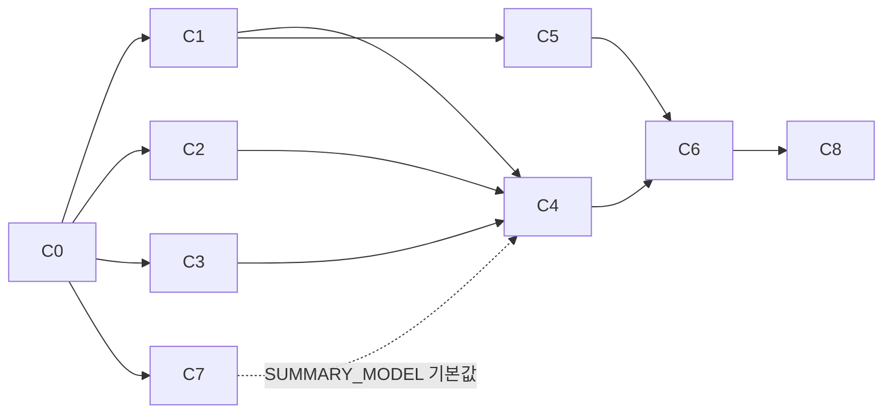

# PLAN — kok.gg 구현 계획

L티어(2~3일) + Phase 2(나중 마일스톤). **한 청크 = implementer(Sonnet) 서브에이전트 1회 호출**. 각 청크는 **실패하는 테스트 먼저 → 구현 → 리팩터**, 청크 끝에서 해당 앱의 테스트·빌드가 그린이 아니면 다음 단계로 넘어가지 않는다.

> 선행 문서: [SPEC.md](./SPEC.md) · [ARCHITECTURE.md](./ARCHITECTURE.md) · [DATA-MODEL.md](./DATA-MODEL.md) · [API.md](./API.md) · [UBIQUITOUS_LANGUAGE.md](./UBIQUITOUS_LANGUAGE.md)
> implementer에게는 **해당 청크 섹션 + 위 5개 문서 경로 + "수정 허용 디렉터리"** 만 준다. 병렬 청크끼리 디렉터리가 겹치지 않게 경계를 명시했다.

---

## 청크 지도

| #   | 청크                               | 산출 핵심                                                                                  | 예상 | 선행         | 병렬 그룹 | 사람 개입                     |
| --- | ---------------------------------- | ------------------------------------------------------------------------------------------ | ---- | ------------ | --------- | ----------------------------- |
| C0  | 스캐폴드 · 계약 고정               | 3개 앱 골격, Prisma/Alembic init, bootstrap.sql, compose, CI(공존 잡)                      | 2~3h | 문서 확정    | —(게이트) | –                             |
| C1  | NestJS API                         | 인증(재사용)·카탈로그 정렬/필터·트렌딩 조회·북마크·관리자 조회·검색 프록시·캐시·레이트리밋 | 4~5h | C0           | **A**     | –                             |
| C2  | 순수 알고리즘                      | 보안 규칙 엔진 16규칙 · daily gains · 트렌드 점수 · 교차검증                               | 4~5h | C0           | **A**     | –                             |
| C3  | FastAPI AI                         | 예산 원장 · 요약(인용 검증) · Kiwi BM25 · 벡터 · RRF · 재순위 · 답변 · sync                | 4~5h | C0           | **A**     | –                             |
| C7  | 요약 모델 평가                     | Haiku 5.5 vs Sonnet 5.5, 20표본, 결정 기록                                                 | 1~2h | C0           | **A**     | **한국어 품질 블라인드 채점** |
| C4  | 배치 파이프라인 + 보안 연동 API    | GitHub 클라이언트·9단계·체크포인트, Override/규칙 API, 설치명령 경고                       | 5~6h | C1·C2·C3     | B         | –                             |
| C5  | 프론트엔드                         | 트렌딩·카탈로그(정렬/필터)·상세·검색·북마크·관리자·방법론·데모 로그인                      | 5~6h | C1 (+디자인) | B         | **디자인 시안 선택(선행)**    |
| C6  | 시드 · 평가 · 문서 · Phase 1 배포  | 데모 시드, 검색 평가, README, Render/Vercel/Actions 라이브                                 | 2~3h | C4·C5        | —         | **배포 승인**                 |
| C8  | Phase 2 — AWS 이전 (나중 마일스톤) | Terraform, Lightsail compose+Caddy, Fargate 스케줄, OIDC→ECR, Cloudflare, 측정             | 4~6h | C6 라이브    | —         | **도메인 결정 · 배포 승인**   |

**병렬 규칙**: API.md·DATA-MODEL.md가 C0에서 코드(스키마·마이그레이션·Zod 스키마)로 고정된 뒤 그룹 A 4개를 동시에 띄운다. 그룹 B 2개(C4·C5)도 서로 디렉터리가 달라 동시 진행 가능.

| 청크 | 수정 허용 디렉터리                                                                                                                                                                           | 금지                                                      |
| ---- | -------------------------------------------------------------------------------------------------------------------------------------------------------------------------------------------- | --------------------------------------------------------- |
| C1   | `backend/src/{auth,users,common,prisma,catalog,bookmarks,search,admin,health}`, `backend/test/`, `backend/scripts/seed-demo-fixtures.ts`                                                     | `security/engine`, `trending/algo`, `ingestion`, `github` |
| C2   | `backend/src/security/engine/**`, `backend/src/trending/algo/**` (+ 같은 위치 `*.spec.ts`)                                                                                                   | 그 외 전부(의존성 추가 금지)                              |
| C3   | `ai/**`                                                                                                                                                                                      | `backend/`, `frontend/`                                   |
| C7   | `ai/evals/**`                                                                                                                                                                                | `ai/app/**` 수정 금지(읽기만)                             |
| C4   | `backend/src/{github,ingestion,security,trending}/*.service.ts`·모듈, `backend/src/admin/security*`, `backend/src/cli.ts`, `backend/scripts/seed-awesome.ts`, `.github/workflows/ingest.yml` | `engine/`·`algo/` 로직 변경 시 C2 테스트 함께 갱신        |
| C5   | `frontend/**`                                                                                                                                                                                | `backend/`, `ai/`                                         |

---

## C0 — 스캐폴드 · 계약 고정 (게이트)

**목표**: 세 앱이 뜨고, 두 마이그레이션 도구가 한 DB에서 공존함이 CI로 증명되고, 병렬 청크가 기댈 계약(스키마·Zod·타입)이 코드로 존재.

1. `backend/`: Nest 11 스캐폴드. runboard에서 `src/common/{filters,pipes,decorators,errors}`, `src/auth`, `prisma.config.ts`, `Dockerfile` 복사 후 조직 개념 제거(인증 테스트는 C1에서 재가동). 의존성은 runboard 세트 + `@nestjs/throttler`만.
2. Prisma: DATA-MODEL.md 3장 스키마 그대로 → `npx prisma validate` → `migrate dev --name init` → `--create-only --name grants`로 `GRANT SELECT ON public.item, public.repo, public.item_source_doc TO kok_ai` 추가.
3. `ai/`: FastAPI + pyproject(ARCHITECTURE 11장 의존성 상한 목록만), `alembic init`, `env.py`(`version_table_schema="ai"`, `include_object`로 ai만), `0001_init`(DATA-MODEL.md 4장 SQL). `alembic upgrade head --sql > backend/test/fixtures/ai-contract.sql` 생성·커밋(Nest 테스트용, 손으로 복사 금지).
4. `infra/db/bootstrap.sql`(DATA-MODEL.md 7장), `infra/docker-compose.yml`(`pgvector/pgvector:pg17` + bootstrap 초기화 + backend + ai).
5. `frontend/`: Vite React TS + Tailwind v4 빈 셸.
6. CI(`.github/workflows/ci.yml`, 워크스페이스 템플릿 기반): `backend`(lint·test·build) / `ai`(ruff·pytest) / `frontend`(build) / **`migrations-coexist`**: 빈 pgvector → bootstrap → `prisma migrate deploy` → `alembic upgrade head` → 계약 뷰 컬럼 검사 → 새 DB에서 역순 재실행 → `ai-contract.sql` 재생성 diff가 비어야 통과.
7. `.github/ISSUE_TEMPLATE/security-appeal.yml`(필드 id: `item_id`, `fingerprint`, `reason`, `evidence`).
8. 첫 테스트(실패→통과): `GET /health`(backend·ai), IT-12(권한 위반이 `permission denied`).

**DoD**: `docker compose up` → 두 `/health` 200, CI 4잡 그린.
**커밋 예**: `chore: NestJS·FastAPI·Vite 스캐폴드`, `feat: Prisma 초기 스키마와 kok_ai 읽기 권한`, `feat: Alembic ai 스키마와 계약 뷰`, `ci: 두 마이그레이션 도구 공존 검증 잡`

---

## C1 — NestJS API (그룹 A)

**목표**: 브라우저가 쓸 API 전부(보안 Override 제외)가 시드 픽스처 위에서 동작.

1. **테스트 먼저**(Testcontainers 1개 공유, 테스트마다 truncate): IT-10, IT-11, IT-13, IT-14, IT-15, IT-16, IT-17 + 북마크(PUT 멱등, 변경 탭 `IS DISTINCT FROM`, ack).
2. `scripts/seed-demo-fixtures.ts`: 저장소 10·항목 20(3종·4등급 상태 섞기)·스타 60일·검사/Finding·`ai` 요약은 **fixture SQL**(kok_ai 롤로 실행 — 소유권 유지).
3. 공통: `@PublicCacheable(profile)` 데코레이터 + 인터셉터(API.md 1.1), 오류는 `no-store`, Throttler 4종 + `TRUST_PROXY`, `DemoReadOnlyGuard`, 커서 코덱(`encode/decode` + 정렬 일치 검사, 단위 테스트).
4. 카탈로그: `GET /api/items` 정렬 4종 × `kind`·`level` keyset(Prisma `OR` 확장, `take+1`), `GET /api/trending`(3쿼리), 상세(4쿼리, 요약 뷰는 `$queryRaw` + Zod 파싱), 스타 시계열(gain 계산은 C2 `dailyGains` 계약 시그니처를 import — C2 미완이면 같은 시그니처로 임시 구현 후 C4에서 교체하지 말고 **C2 완료를 기다려 연결**), 저장소 상세, 통계.
5. 검색 프록시: FastAPI 호출(타임아웃 8s, 에러 매핑), `itemId[]` → `ItemCard` 1쿼리.
6. 관리자 조회: 실행 목록/상세, 데이터 품질 요약·목록·처리, 수동 실행 요청(`workflow_dispatch` 호출, 토큰 없으면 `dispatched:false`).
7. 정렬별 `EXPLAIN` 확인 스크립트(`test/explain-catalog.ts`): 8개 조합이 인덱스 스캔인지 출력 — 결과를 PR 설명에 첨부.

**DoD**: 위 테스트 그린, Swagger에 전 엔드포인트, `level=DANGER` 필터 EXPLAIN 기록.
**커밋 예**: `feat: 카탈로그 정렬 4종과 keyset 커서`, `feat: 공개 응답 캐시 프로필`, `feat: 북마크와 보안 등급 변경 탭`, `feat: 검색 프록시와 레이트리밋`, `test: 카탈로그 커서 연속성 통합테스트`

---

## C2 — 순수 알고리즘 (그룹 A, 이 프로젝트의 심장)

**목표**: IO 없는 모듈 3개가 표 기반 테스트로 고정. 라인 커버리지 95%+.

1. **테스트 먼저 — 트렌드** (`trending/algo/*.spec.ts`): TA-1~TA-9(아래 표). ARCHITECTURE 5.2 예시 표를 그대로 테스트 케이스로.
2. 구현: `dailyGains(rows)`, `computeTrendScore(series, { window, asOf, totalStars, repoCreatedAt }, params = TREND_PARAMS)`, `crossValidateStars(rows, opts)` — 모두 순수 함수, 날짜는 `YYYY-MM-DD` 문자열로 다뤄 타임존 버그 차단.
3. **테스트 먼저 — 보안**(`security/engine/**/*.spec.ts`): 규칙 16개 × **양성 ≥ 3 · 음성 ≥ 3**(ARCHITECTURE 6.3 표의 예시 포함), TS-공통 9개(아래).
4. 구현: `extractTargets()`(hooks.json·plugin.json 인라인/경로·마켓플레이스 인라인 hooks·monitors·MCP·SKILL.md 프런트매터/코드블록/본문·스크립트 해석), `preprocess()`, `rules/R01…R16.ts`(각 파일 = 메타 + match), 복합 R05, `fingerprint()`, `aggregate()`, `scan(input): ScanResult`. 규칙 메타(`titleKo`·`descriptionKo`·`regions`)는 이 모듈이 **단일 원천** — API의 `/security/rules`가 그대로 노출.
5. `RULE_SET_VERSION`, `TREND_PARAMS`(+`PARAMS_VERSION`) 상수.

**DoD**: `npm test -- security/engine trending/algo` 그린, 커버리지 리포트 95%+, ReDoS 테스트 전 규칙 50ms 이내.
**커밋 예**: `feat: 일일 증가량과 트렌드 점수 순수 함수`, `test: 트렌드 점수 표 기반 테스트`, `feat: 훅·스킬·MCP 대상 추출기`, `feat: 보안 규칙 R01~R16`, `test: 규칙별 양성·음성 및 ReDoS 테스트`

---

## C3 — FastAPI AI (그룹 A)

**목표**: 배치가 부를 `/internal/jobs/sync`와 NestJS가 부를 검색·답변이 예산 안에서 동작.

0. **측정 먼저**: Kiwi 로드 후 RSS 측정(모델 타입별) → 400MB 목표 내 설정 확정, 결과를 `ai/README` 표로. 초과 시 경량 모델 타입.
1. **테스트 먼저**(pytest + testcontainers pgvector, 외부 API는 httpx mock): TF-1~TF-13(아래 표).
2. `budget/ledger.py`: 조건부 UPDATE 예약·정산·해제(ARCHITECTURE 9.2), 하루 첫 호출 시 `budget_day` 3행 `ON CONFLICT DO NOTHING` 생성.
3. `summary/`: 전처리(배지·HTML·링크 URL 제거, 본문 길이 계산), `quote_verify.py`, 구조화 출력 호출(`messages.parse(output_format=SummaryOut)`), 상태 결정, `PROMPT_VERSION`.
4. `search/`: Kiwi 토큰화(품사 필터), 순수 BM25(k1=1.2, b=0.75), RRF, 벡터 쿼리(`hnsw.iterative_scan`), Voyage 재순위, 캐시(`index_version` 포함 키), degraded 경로, 답변(인용 검증).
5. `jobs/sync.py`: pending 선정 SQL(해시 비교) → 항목별 요약·임베딩·search_doc upsert → BM25 재구축 → `index_version++` → 만료 캐시 청소.
6. `security.py`: `X-Internal-Token` `hmac.compare_digest`, 운영에서 `/docs` 비활성.
7. 검색 평가 세트 뼈대 `evals/search_eval.yaml`(질의 20개 — 정답 라벨은 C6에서 실데이터로 채움).

**DoD**: pytest 그린, 이미지 빌드 후 컨테이너 RSS 기록, `/internal/search`가 픽스처로 결과 반환.
**커밋 예**: `feat: 원자적 일일 AI 예산 원장`, `feat: 인용 검증 기반 한국어 요약`, `feat: Kiwi BM25와 pgvector 하이브리드 검색`, `feat: 근거 인용 검증 답변`, `test: 동시 예산 예약 경쟁 테스트`

---

## C7 — 요약 모델 평가 (그룹 A, 작음)

1. `evals/samples.yaml`: GitHub에서 고른 실제 저장소 20개(플러그인 5·스킬 5·훅 5·빈약한 README 3·한국어 README 2), 원문은 실행 시 내려받아 `evals/.cache/`(gitignore).
2. `summary_eval.py`: 같은 프롬프트·스키마로 `claude-haiku-5-5`·`claude-sonnet-5-5` 각 20회 → 지표: **인용 검증 통과율**(검증된/반환된 설치 명령), **필수 필드 누락률**(원문 충분한데 빈 필드), INSUFFICIENT 판정 일치, 지연, 비용. 한국어 품질은 모델명을 가린 A/B 시트(`evals/blind.md`)로 출력.
3. **사람 개입**: 사용자가 블라인드 시트에 1~5점 채점(또는 메인 세션 Opus가 루브릭 채점 후 사용자 확인).
4. 결정 규칙: Sonnet이 인용 통과율 **+10%p 이상** 또는 한국어 평균 **+0.5 이상**일 때만 Sonnet, 아니면 Haiku. `evals/RESULT.md`에 표 + 결정 + `SUMMARY_MODEL` 기본값 반영.

**DoD**: RESULT.md 커밋. **커밋 예**: `test: 요약 모델 비교 평가 스크립트`, `docs: 요약 모델 평가 결과와 선택 근거`

---

## C4 — 배치 파이프라인 + 보안 연동 API (그룹 B)

**목표**: `node dist/cli.js ingest`가 실제 GitHub에서 끝까지 돌고, 재실행이 멱등.

0. **실제 응답 캡처 먼저**: Star History(`week` 형식·이번 주 포함 여부·무인증/인증 차이·`x-ratelimit-resource`), GraphQL `nodes` 응답, 코드 검색 1페이지, raw 조회의 레이트리밋 차감 여부를 1회 호출해 `test/fixtures/github/*.json`으로 저장. ARCHITECTURE의 **[미검증]** 항목을 확인 결과로 갱신(문서 커밋 포함).
1. **테스트 먼저**: IT-1~IT-9(아래 표) — GitHub은 픽스처 기반 fake 서버(`undici` MockAgent — Node 내장 fetch와 같은 패키지라 추가 의존성 없음 [구현 시 확인]), FastAPI는 HTTP mock.
2. `github.client.ts`: 리소스별 토큰 버킷(search 30/분, code 10/분), 잔량 추적·`GITHUB_CORE_RESERVE`, 백오프(403/429/422), 동시성 4.
3. `ingestion/`: `pipeline.ts`(advisory lock → run upsert → 단계 순회), `checkpoint.service.ts`(묶음 50개 커밋마다 cursor 갱신), 9개 `*.stage.ts`. discover(토픽·코드 검색 `size:` 순환), qualify(트리 판별·마켓플레이스 펼치기·상한), snapshot(GraphQL 100개 + item 비정규화 UPDATE), star-history(백필 + 요일 순환), fetch-content(headSha 변경분만, 크기 상한), security-scan(C2 `scan()` 호출 + 저장 + 활성 Override 적용), ai-sync(FastAPI 반복), trending(C2 함수 + 순위·전일 순위 + 비정규화 + 90일 정리), quality(C2 교차검증 → 이슈 upsert).
4. 외부 출처 어댑터 `external-star-source.ts`: `EXTERNAL_STAR_SOURCE`·`…_UNTIL` 체크, OSS Insight 호출(600/h/IP 존중). 종료일 이후 자동 no-op 테스트.
5. 보안 연동 API: Override 생성·철회(한 트랜잭션 재계산), `GET /api/security/rules`(C2 메타), 상세의 `installCommands[].warnings`.
6. `.github/workflows/ingest.yml`: `schedule: '0 18 * * *'` + `workflow_dispatch(inputs: run_id, stages)`, `concurrency: ingest`, GHCR 이미지 `docker run … node dist/cli.js ingest`. `scripts/seed-awesome.ts`.

**DoD**: 로컬에서 `MAX_TRACKED_REPOS=50`으로 실제 GitHub 1회 완주 + 즉시 재실행 시 외부 호출 최소·행 수 불변, 실행 통계(`ghCoreUsed`)가 예산표 이내.
**커밋 예**: `feat: 레이트리밋 예산 GitHub 클라이언트`, `feat: 단계별 체크포인트 수집 파이프라인`, `feat: 마켓플레이스 펼치기와 판별`, `feat: 공식 스타 기록 백필과 교차검증`, `feat: 보안 예외 처리 트랜잭션`, `ci: 일일 수집 워크플로`

---

## C5 — 프론트엔드 (그룹 B, 디자인 시안 선택 후)

1. 스택: Vite + React + TS + Tailwind v4 + Zustand(auth·UI) + TanStack Query + Axios(401 → refresh 1회 + 큐잉, runboard 인터셉터 재사용) + Recharts + lucide-react + Zod(`shared/schemas`, API.md 기준).
2. **URL이 상태**: 카탈로그 `?kind&level&sort&cursor`를 URL 쿼리로(공유 가능), 직렬화는 고정 순서 유틸 1개(단위 테스트). 응답 `asOf`가 바뀌면 무한 스크롤 초기화.
3. 화면: 홈(검색창 "이런 거 있어?" + 트렌딩 1d/7d/30d 탭 + 종류 필터), 카탈로그(정렬 4종 세그먼트 + kind/level 칩 — 어떤 조합도 가능), 항목 상세(요약 "AI 생성 · 원문 확인" 라벨, 정보 부족 상태, 설치 명령 + 경고, **위험 신호 탐지** 패널: 등급 배지·Finding `file:line` 퍼머링크·발췌는 텍스트 노드·면책·"오탐 신고" Issue 링크(항목 id·fingerprint 프리필), 스타 차트(gain null 구간 끊김)), 검색(결과 먼저 → 답변 카드 지연 로드, degraded 안내, `SEARCH_WARMING` 재시도 안내), 북마크(+ 보안 등급 변경 탭·확인), 관리자(실행·트리거·이슈·Override·AI 사용량; `isDemo && 운영`이면 변경 버튼 비활성 + 안내), 보안 방법론(`/security/rules` 렌더 + 알려진 상한), 로그인/가입.
4. **데모 로그인**: 로그인 화면 상단에 버튼 `회원가입 없이 둘러보기`, 바로 아래 `회원가입 없이 체험해 볼 수 있습니다.` — 고정 문구, 원클릭 로그인.
5. 접근성: 등급 배지는 색 + 아이콘 + 텍스트(색만으로 구분 금지), 키보드 탐색, 차트 대체 텍스트(최근 7일 증가량 요약).
6. 금지: 요약·발췌·README 문자열을 `dangerouslySetInnerHTML`/마크다운으로 렌더(테스트로 grep 금지 규칙).

**DoD**: `npm run build` 그린, 로컬 compose + 픽스처로 전 화면 동작, 정렬·필터 조합 URL 왕복.
**커밋 예**: `feat: 트렌딩과 카탈로그 정렬 필터 화면`, `feat: 항목 상세 위험 신호 패널`, `feat: 자연어 검색과 답변 카드`, `feat: 북마크 등급 변경 탭`, `feat: 관리자 콘솔`, `feat: 데모 로그인 버튼`

---

## C6 — 시드 · 평가 · 문서 · Phase 1 배포

1. `scripts/seed-admin.ts`(idempotent): `admin`/`admin`(ADMIN) + 실데이터 항목 위 북마크 3(1개는 `seenLevel`을 현재와 다르게 → 변경 탭 1건), Override 1, 이슈 2, 실행 이력 2.
2. 검색 평가: `search_eval.yaml` 정답 라벨 채우기 → BM25 단독 / 벡터 단독 / 하이브리드 / 하이브리드+재순위의 Recall@10·MRR 표를 README에(면접 자료).
3. README: 템플릿 기반 + mermaid 아키텍처 + **트렌드 공식과 5.2 예시 표** + **규칙 표 + 알려진 상한** + 두 스키마 소유권 + 비범위 요약 + 데모 GIF + 라이브 URL + Phase 2 계획.
4. 배포: Neon 프로젝트 → bootstrap.sql(소유자) → Render 2서비스(Docker, 환경변수, `/health`) → Vercel → GHCR 이미지 → Actions 시크릿 → 수동 dispatch 1회 완주 확인 → **사람 승인 게이트**(라이브 미리보기 + 리뷰 요약) → 크론 활성화.
5. `DEMO_ADMIN_READONLY=true` 운영 설정 확인(IT-13을 라이브에 수동 재현).

**DoD**: 라이브 URL에서 데모 버튼 1클릭 → 트렌딩·카탈로그 정렬·상세 위험 신호·검색 답변·북마크 변경 탭·관리자 대시보드 확인.
**커밋 예**: `chore: 데모 관리자 시드`, `docs: README와 검색 평가 결과`, `chore: Render·Vercel 배포 설정`

---

## C8 — Phase 2: AWS 이전 (나중 마일스톤 · 공개 런칭 전제)

**공개 런칭(유튜브·커뮤니티 공유)은 이 마일스톤 완료 후 권장.**

1. **이전 전 측정**(Phase 1): 콜드스타트(첫 바이트), 트렌딩·검색 미스 p95, 월 비용, 배포 소요.
2. Terraform(`infra/aws/terraform`, 로컬 state + S3 백엔드는 선택): ECR 2개(수명주기 5개), GitHub OIDC 공급자 + 배포 역할(ECR push·`ecr:GetAuthorizationToken`만), ECS 클러스터 + 배치 태스크 정의(0.5vCPU/1GB, `batch:stable`, SSM 시크릿 주입, 로그 7일), 보안 그룹(인바운드 0), EventBridge Scheduler(`cron(0 18 * * ? *)`, 퍼블릭 서브넷, `assignPublicIp=ENABLED`, NAT 없음) + 실행 역할, SSM Parameter Store(SecureString), Lightsail 1GB 인스턴스 + 고정 IP + 포트(443은 Cloudflare 대역만, 22 키 인증), **AWS Budgets 알람**(월 $12, 80%·100% 이메일).
3. `compose.prod.yml`(backend·ai·caddy, 메모리 제한 + 스왑 1GB), `Caddyfile`(api 호스트, Cloudflare `trusted_proxies`, `/internal/*`은 ai로 프록시하되 토큰은 FastAPI가 검사).
4. `deploy-aws.yml`: OIDC → 이미지 빌드·ECR push → `batch:stable` 태그 이동 → SSH로 단기 ECR 토큰 전달·`compose pull && up -d`.
5. Cloudflare: 도메인 NS 위임(등록처는 사용자 결정), `kok.gg`/`www` → Vercel(DNS only), `api.kok.gg` → Lightsail(proxied, SSL Full strict), 캐시 규칙(공개 읽기 경로, 원본 Cache-Control 존중).
6. 컷오버: Vercel `VITE_API_BASE_URL` 교체 → Actions 크론 비활성(수동 dispatch 워크플로는 유지) → Render 서비스 정지.
7. **이전 후 측정** → README에 전후 비교표(콜드스타트·p95·월 비용·NAT 회피 절감액) = 면접 스토리 "PaaS→AWS 이전".

**DoD**: `api.kok.gg/health` 200(Cloudflare 경유), EventBridge 실행 1회 성공 로그, Budgets 알람 활성, 비교표 커밋.
**커밋 예**: `feat(infra): Terraform으로 ECR·Fargate 스케줄·Lightsail 구성`, `ci: OIDC 기반 ECR 배포 워크플로`, `docs: PaaS→AWS 이전 전후 비교`

---

## 테스트 시나리오 목록

### TA — 트렌드·교차검증 순수 함수 (C2, Jest)

| ID   | 시나리오                                        | 기대                                          |
| ---- | ----------------------------------------------- | --------------------------------------------- |
| TA-1 | ARCHITECTURE 5.2 예시 A~D                       | 표의 점수(±0.5) · D는 `null`                  |
| TA-2 | 같은 G, S0만 증가                               | 점수 단조 감소                                |
| TA-3 | 전일 스냅샷 없음, 공식 기록 없음                | gain `null` — 누적 총합을 하루치로 계산 안 함 |
| TA-4 | 7일 중 known 5일(0.71)                          | `null`                                        |
| TA-5 | 나이 10일 저장소의 D7                           | A = 1                                         |
| TA-6 | 집중도 c = 0.6 / 1.0                            | pen = 1 / 0.4                                 |
| TA-7 | 점수 동률 3개                                   | `G desc, repo_id asc`로 결정적                |
| TA-8 | 교차검증 차이가 허용오차와 정확히 같음 / 1 초과 | 통과 / `STAR_SOURCE_MISMATCH`                 |
| TA-9 | 스냅샷 전일 대비 −20% / −21%                    | 통과 / `STAR_ANOMALY`                         |

### TS — 보안 규칙 엔진 (C2, Jest)

| ID   | 시나리오                                                                          | 기대                                    |
| ---- | --------------------------------------------------------------------------------- | --------------------------------------- |
| TS-1 | 규칙 16개 × 양성 ≥3 / 음성 ≥3                                                     | 각각 검출 / 미검출                      |
| TS-2 | 규칙별 100KB 적대 입력(반복 패턴)                                                 | 50ms 이내                               |
| TS-3 | `\` 줄 잇기로 쪼갠 `curl … \| \n bash`                                            | R01, line = 시작 줄                     |
| TS-4 | 전체 줄 주석 `# curl x \| sh` / 셔뱅                                              | 미검출 / 셔뱅은 주석 아님               |
| TS-5 | 같은 코드 위에 빈 줄 3개 추가                                                     | fingerprint 동일, line만 변경           |
| TS-6 | 한 파일 R03 + R04 / 서로 다른 파일                                                | R05 DANGER / R05 없음                   |
| TS-7 | hooks.json 안 명령의 줄 번호                                                      | 원문 줄과 일치                          |
| TS-8 | `${CLAUDE_PLUGIN_ROOT}/scripts/a.sh` 참조, `bin/` 바이너리, 경로 탈출(`../`) 참조 | a.sh 검사 / R16 / 탈출 경로는 무시+기록 |
| TS-9 | 집계: DANGER 1 + CAUTION 3 → DANGER, 억제된 DANGER만 있으면 CAUTION/SAFE          | 규칙대로                                |

### TF — FastAPI (C3, pytest + testcontainers)

| ID    | 시나리오                                                       | 기대                                                 |
| ----- | -------------------------------------------------------------- | ---------------------------------------------------- |
| TF-1  | cap = 10건분, 동시 예약 50개                                   | 성공 정확히 10, 외부 호출 mock 10회, DB CHECK 위반 0 |
| TF-2  | 예약 후 호출 예외                                              | reserved 원복                                        |
| TF-3  | 인용 검증: 원문 그대로 / 공백만 다름 / 따옴표 변경 / 버전 추정 | 통과 / 통과 / 탈락 / 탈락                            |
| TF-4  | 본문 280자                                                     | `INSUFFICIENT`, Claude 호출 0                        |
| TF-5  | 같은 sha 재동기화 / sha 변경                                   | Claude 0회 / 1회                                     |
| TF-6  | 고정 코퍼스 BM25                                               | 기대 순위                                            |
| TF-7  | RRF 두 목록                                                    | 손 계산 값                                           |
| TF-8  | "PR 올리기 전에 lint 돌려주는 hook"                            | 토큰에 `pr`, `올리`, `lint`, `hook` 등 기대 포함     |
| TF-9  | SEARCH 풀 소진                                                 | `degraded: true`, Voyage 호출 0                      |
| TF-10 | 답변이 top5 밖 id 인용                                         | `answerKo: null`, `CITATION_INVALID`                 |
| TF-11 | 캐시 히트 / `index_version` 증가 후                            | 외부 호출 0 / 미스                                   |
| TF-12 | 내부 토큰 없음·틀림                                            | 401                                                  |
| TF-13 | `kind=HOOK` 벡터 검색                                          | HOOK만 반환                                          |

### IT — NestJS 통합 (C1·C4, supertest + Testcontainers `pgvector/pgvector:pg17` + bootstrap + `ai-contract.sql`)

| ID    | 시나리오                                                                           | 기대                                                          |
| ----- | ---------------------------------------------------------------------------------- | ------------------------------------------------------------- |
| IT-1  | 같은 `as_of`로 ingest 2회                                                          | 모든 테이블 행 수 동일                                        |
| IT-2  | snapshot 단계 2묶음 처리 후 강제 예외 → 재실행                                     | 커서부터 재개, 중복 0                                         |
| IT-3  | ingest 2개 동시 시작                                                               | 1개만 진행, 다른 쪽 종료 코드 0                               |
| IT-4  | core 잔량 < reserve 응답                                                           | 단계 `PAUSED` + 커서 저장, 다음 단계 진행, 다음 실행이 이어감 |
| IT-5  | 마켓플레이스: 상대경로·github·git-subdir·npm·command 혼합                          | Item·Candidate·`UNSUPPORTED`·R14 정확                         |
| IT-6  | headSha 불변 재실행                                                                | fetch-content·scan 외부 호출 0                                |
| IT-7  | 신규 저장소 공식 기록 3회 실패 + 전일 스냅샷 없음                                  | gain `null`, 트렌드 없음, `OFFICIAL_HISTORY_FAILED` 1건       |
| IT-8  | 스냅샷 vs 공식 불일치 주입 후 재실행                                               | 이슈 1건(중복 없음)                                           |
| IT-9  | Override 생성 → 규칙 버전 올려 재검사 → 매칭 줄 수정 후 재검사                     | 등급 즉시 재계산·북마크 변경 탭 노출 → 유지 → 신호 재노출     |
| IT-10 | `/api/items` 정렬 4 × kind(전체·3) × level(전체·3) 전 페이지 순회                  | 정렬 단조, 중복·누락 0, 다른 정렬 커서 400, 미지 파라미터 400 |
| IT-11 | 공개 엔드포인트에 Authorization 유무                                               | 응답 본문 동일 + 프로필 헤더, me/admin/오류는 `no-store`      |
| IT-12 | kok_app으로 `ai.item_summary` INSERT / kok_ai로 `public.bookmark` SELECT           | 둘 다 `permission denied`                                     |
| IT-13 | `DEMO_ADMIN_READONLY=true`: 데모 관리자 POST override / GET 목록 / 일반 ADMIN POST | 403 `DEMO_READ_ONLY` / 200 / 201                              |
| IT-14 | `admin` 로그인 / `not-an-email` 로그인 / `admin`으로 가입 / 틀린 비번              | 200 / 400 / 400 / 401                                         |
| IT-15 | 같은 IP 검색 21회                                                                  | 21번째 429 `RATE_LIMITED`                                     |
| IT-16 | 항목 상세 1회                                                                      | Prisma 쿼리 ≤ 4(+ 요약 raw 1)                                 |
| IT-17 | FastAPI 미응답                                                                     | 503 `SEARCH_WARMING` + `Retry-After`, `no-store`              |

---

## 검수 체크리스트 (청크 완료마다 메인 세션)

- [ ] 판정 경로(보안 등급)에 LLM 호출이 없는가 — `security/` 아래 AI 클라이언트 import 0
- [ ] 모르는 날을 0이나 누적 차분으로 메우는 코드가 없는가(TA-3)
- [ ] 공개 엔드포인트가 사용자별 데이터를 섞지 않고 캐시 프로필이 붙었는가
- [ ] NestJS가 `ai` 테이블에 쓰는 코드·FastAPI가 `public`에 쓰는 코드가 없는가(DB 권한이 최종 방어)
- [ ] 루프 안 `findUnique`/개별 쿼리 없음(N+1), 묶음은 `ANY($ids)`
- [ ] 외부 문자열(요약·발췌·README)이 HTML로 렌더되지 않는가
- [ ] 새 의존성은 ARCHITECTURE 11장 상한 안인가(ponytail), `.env`·시크릿 커밋 없음
- [ ] 공개 함수 JSDoc/docstring은 "왜" 중심, 비자명 로직(예산 원자성·keyset·급등 보정·지문)에만 인라인 주석
- [ ] **[미검증]** 표기가 확인 결과로 갱신됐는가(C4-0, C3-0)
- [ ] Conventional Commits, 한 커밋 한 변경
